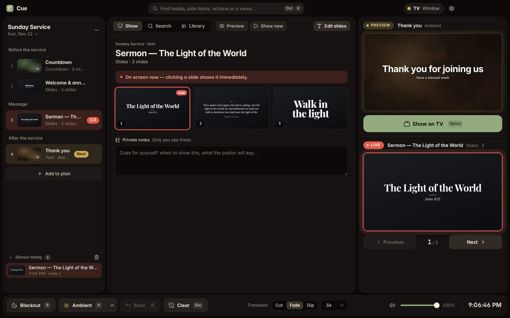
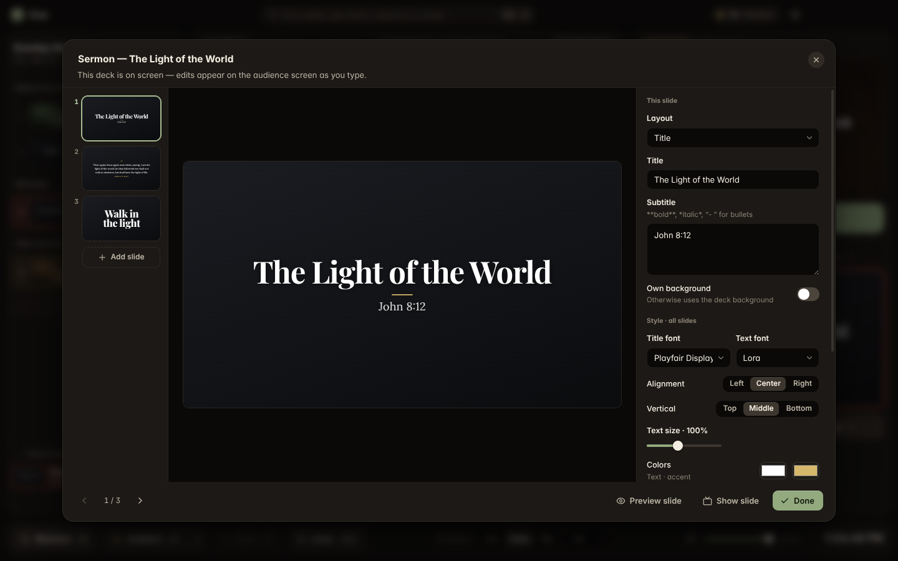
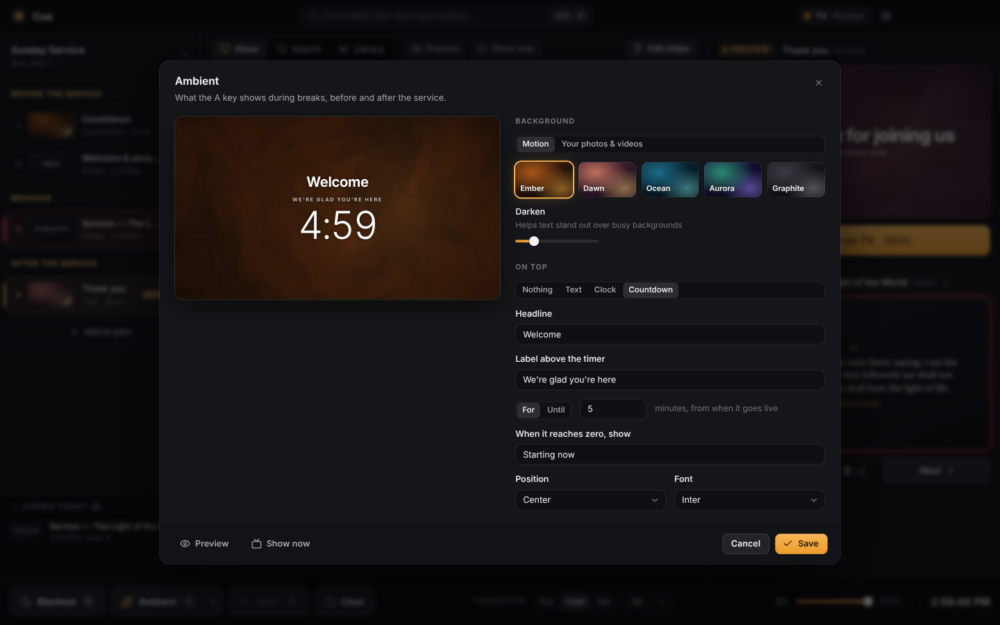

# Cue — Church Presentation App

Cue is a cross-platform church presentation application for macOS and Windows. It helps an operator find and prepare visuals privately, then send selected content to a separate TV or projector during a church service.



## What Cue does

- **Google Images, built in.** Search Google Images inside Cue. Click a result and the full-size original lands in **Preview**; one more click or key puts it on screen. There's no manual downloading and no switching apps. Wikimedia Commons, Openverse and Pexels are built in too, with license and attribution for every image.
- **Preview, then Live.** Nothing reaches the room until you press **Show**. The Preview and Live monitors show exactly what the audience sees, including transitions, zoom and blackout.
- **Service plans.** Line up slides, PDFs, photos, videos, countdowns and section headings, then run the service with one key. The next item waits in Preview automatically. Plans export as a single `.cueplan` file with all their media, so you can prepare at home and run at church.
- **Spontaneous moments.** Show a map the pastor just mentioned, paste an image or link (Ctrl/⌘+V), or type a quick text slide (Ctrl/⌘+T). **Back** (R) returns to your sermon slides at the page you left.
- **Media library.** Images, animated GIFs, videos, audio and PDFs are copied into Cue so everything works offline. Favorites, collections, "Recently shown" and a "Shown today" history make things easy to find again.
- **Slides.** Import PDF presentations (PowerPoint and Keynote: export as PDF) or make simple text slides with title, scripture, big-word and lower-third layouts. Edit a deck while it's on screen and the audience sees the fix as you type. Between slides that share a background only the words change, so a motion background keeps playing.
- **Scripture.** Type a reference such as `John 3:16`, `ps 23` or `Rom 8:38-39` into the command palette (Ctrl/⌘+K) or a quick text slide and the passage is ready to show. The World English Bible and the King James Version are built in and work offline; a long passage is spread evenly over as many slides as it needs.
- **Ambient mode.** Calm motion backgrounds or a slideshow of your own photos and videos, with an optional welcome message, clock or countdown, for before, between and after the service (A).
- **Full control of the screen.** Blackout (B), fit / fill / blur-fill, zoom and pan, cut / fade / dip transitions, video transport with loop and end actions, volume and mute, choice of audio output (HDMI or sound desk), overscan inset, a test pattern and display identification.
- **Built for live use.** Cue never puts the audience window on your own screen, switches to the TV when it's plugged in, keeps the computer awake, and after a crash or power cut puts the audience screen back exactly as it was.

| Slides, edited live                                                             | Ambient and countdown                                                      |
| ------------------------------------------------------------------------------- | -------------------------------------------------------------------------- |
|  |  |

## Install

One line installs Cue: it downloads the newest version, checks it against the published checksum, installs it and opens it.

**Windows** (10 or 11): open PowerShell (press Start, type `powershell`, press Enter) and paste:

```powershell
irm https://raw.githubusercontent.com/lowkeyjojo/cue-church-app/main/install.ps1 | iex
```

**macOS** (12 Monterey or later, Apple Silicon and Intel): open Terminal and paste:

```bash
curl -fsSL https://raw.githubusercontent.com/lowkeyjojo/cue-church-app/main/install.sh | bash
```

Or download it yourself. These two links always fetch the newest version:

- **Windows:** [Cue-windows-setup.exe](https://github.com/lowkeyjojo/cue-church-app/releases/latest/download/Cue-windows-setup.exe). Run it: Cue installs for your user account, with no questions and no administrator prompt, and opens when it's done.
- **macOS:** [Cue-mac.dmg](https://github.com/lowkeyjojo/cue-church-app/releases/latest/download/Cue-mac.dmg). Open it and drag Cue into Applications.

The first time Cue opens, a short welcome sets up your screen.

**You only install once.** On Windows, Cue keeps itself up to date: a new version downloads in the background and installs when you close Cue, never during a service. On a Mac, Cue tells you when a new version is out; run the line above again, or download the new disk image. **Settings → Library → Updates** has the switch and a **Check now** button.

**"Can't be verified" prompts.** Cue's builds aren't signed with a paid developer certificate yet, so a copy downloaded with a browser makes the system ask once before it runs. That's the only reason for the prompt, and you never need to turn any protection off to get past it:

- **Windows:** in the blue "Windows protected your PC" box, click **More info**, then **Run anyway**. Leave SmartScreen and Defender switched on.
- **macOS:** open Cue once (macOS refuses), then go to **System Settings → Privacy & Security**, scroll down and click **Open Anyway**.

The one-line installers don't meet that prompt, because they fetch the file directly rather than through a browser, and they refuse to run it unless its SHA-256 matches the release's `SHA256SUMS.txt`. If Windows 11 says **Smart App Control** blocked Cue, that PC runs signed apps only: leave it on, and Cue will work there once the builds are signed.

Signing removes the prompts for everyone: an Apple Developer ID (Apple Developer Program) for macOS and a code-signing certificate for Windows. The release workflow signs automatically once those are added as repository secrets (see Development).

## Your first Sunday

1. **Connect the TV or projector** as a second display. Cue shows its audience screen there automatically; the badge at the top right says where. Use **Identify** if you're not sure which display is which, and the **test pattern** to check the picture fits the screen.
2. **Plan the service** in the left panel: drag in slides, PDFs, photos and videos, and add a countdown for before the service.
3. **Run it:** click an item to preview it, press **Space** to show it, use **→ / ←** for slides. The next item is already waiting in Preview.
4. **When something comes up,** press **Ctrl/⌘+L**, search, click the image, and press **Ctrl/⌘+Enter**. Press **R** to go back to the sermon.
5. **During a break,** press **A** for ambient or **B** for blackout. The next key brings the content back.

The [Operator guide](docs/OPERATOR_GUIDE.md) walks through a whole service, with tips for rehearsal and troubleshooting.

## Keyboard shortcuts

| Key                | Action                                                    |
| ------------------ | --------------------------------------------------------- |
| Space              | Show the preview on screen                                |
| Ctrl/⌘ + Enter     | Show the preview, even while typing or browsing Google    |
| → / ←              | Next / previous slide or page (also Page Down / Page Up)  |
| B                  | Blackout on/off (Shift + Ctrl/⌘ + B works anywhere)       |
| A                  | Ambient on/off (Shift + Ctrl/⌘ + A works anywhere)        |
| R                  | Back to what was showing before (e.g. your slides)        |
| F                  | Cycle fit → fill → blur                                   |
| + / − / 0          | Zoom in, zoom out, reset zoom                             |
| K / M              | Play or pause video / mute                                |
| 1 … 9              | Preview plan item 1–9                                     |
| Ctrl/⌘ + K         | Command palette: media, plan items, actions, Bible verses |
| Ctrl/⌘ + L         | Search images                                             |
| Ctrl/⌘ + V         | Paste an image, link or text into Preview                 |
| Ctrl/⌘ + T         | Quick text slide                                          |
| Ctrl/⌘ + I         | Import media                                              |
| Ctrl/⌘ + 1 / 2 / 3 | Show, Search or Library tab                               |
| Ctrl/⌘ + ,         | Settings                                                  |

After you click anything with the mouse, Space still means Show. When you move around with Tab instead, Space and Enter press the focused control as usual (on a library item, Enter puts it in Preview).

## Image search, copyright and privacy

- **Google Images** runs as the real Google page inside Cue. Cue doesn't scrape or proxy Google's results or call any unofficial API. It notices the image you open and fetches that one file for you, so Google's own terms, SafeSearch (on by default) and usage-rights filter apply as usual. Google's own Custom Search JSON API stops serving results on 1 January 2027, which is another reason Cue embeds the page rather than depending on it.
- **Wikimedia Commons, Openverse and Pexels** are searched through their public APIs. Results show the author and license; a Pexels API key (free) is optional.
- **Copyright:** images you find online usually belong to someone. Cue records where every image came from (page, author, license) and can show a small credit on screen. Prefer the Creative Commons filter or the openly licensed sources when you can, and follow your church's copyright licenses (e.g. for song lyrics).
- **Bible text:** Cue includes only public-domain translations. The World English Bible (published by eBible.org) comes from [TehShrike/world-english-bible](https://github.com/TehShrike/world-english-bible) and the King James Version from [thiagobodruk/bible](https://github.com/thiagobodruk/bible); `npm run bible` rebuilds both. The KJV is public domain except in the United Kingdom, where the Crown's rights in it are administered by Cambridge University Press. Modern translations such as the NIV or ESV are licensed, so type or paste their text into a slide under your church's license instead.
- **Privacy:** Cue has no account, no analytics and no telemetry. Your library, plans and settings stay on your computer. Pages in the browser pane keep their own cookies, separate from Cue's windows.

## Development

Requirements: **Node.js 22.12 or later** and npm. Cue is Electron + React + TypeScript, built with electron-vite.

```bash
npm ci
```

```bash
npm run dev
```

`npm run dev` starts Cue with hot reload. With only one display, open the audience window from the output badge (top right) or **Output → Floating Window**.

| Command             | What it does                                                                 |
| ------------------- | ---------------------------------------------------------------------------- |
| `npm run build`     | Bundle main, preload and renderer code into `out/`                           |
| `npm start`         | Run the built bundle                                                         |
| `npm run typecheck` | TypeScript, for both the Node and the browser side                           |
| `npm run lint`      | ESLint (`npm run format` applies Prettier)                                   |
| `npm test`          | Unit tests (Vitest): the show reducer, scripture, layout and utilities       |
| `npm run test:e2e`  | Build, then drive the real app with Playwright (uses Xvfb on headless Linux) |
| `npm run check`     | Typecheck, lint and unit tests together                                      |
| `npm run dist:mac`  | Package for macOS (on a Mac): `release/<version>/Cue-mac.dmg`                |
| `npm run dist:win`  | Package for Windows (on Windows): `Cue-windows-setup.exe` and `latest.yml`   |
| `npm run dist:dir`  | Unpacked app for the current platform, for a quick smoke test                |
| `npm run icons`     | Redraw the app icons in `build/` and `resources/`                            |
| `npm run art`       | Redraw the Mac disk image's background from `build/installer/`               |
| `npm run bible`     | Download the bundled Bible translations again into `resources/bible/`        |

The end-to-end suite launches Cue with a throwaway data folder and a local stand-in for Google Images, so it needs no network. Pass Playwright arguments through, for example `npm run test:e2e -- tests/e2e/google.spec.ts`, and add `--no-build` to reuse the current `out/`.

**Packaging and signing.** `electron-builder.config.mjs` builds one universal DMG for macOS (Apple Silicon and Intel) and one one-click installer for Windows (x64, which also runs on Windows 11 on ARM). Signing is optional and configured through environment variables: `CSC_LINK` and `CSC_KEY_PASSWORD` (Developer ID certificate), plus `APPLE_ID`, `APPLE_APP_SPECIFIC_PASSWORD` and `APPLE_TEAM_ID` for notarization; `WIN_CSC_LINK` and `WIN_CSC_KEY_PASSWORD` for Windows. Without them the Mac app is ad-hoc signed so it still runs on Apple Silicon. The **Release** workflow builds both platforms, then installs each build on a clean machine with the one-line installers (`install.ps1`, `install.sh`) and checks that Cue opens (`scripts/smoke-installed.mjs`). On Windows it also installs an older copy and checks that it updates itself to the new build (`scripts/smoke-update.mjs`). Nothing is published unless all of that passes. To publish a GitHub release, push a tag like `v1.0.0`, or run the workflow from the Actions tab with that version (it creates the tag); the version has to be the one in `package.json`. The same variables can be added as repository secrets.

**Releases and updates.** The download names carry no version (`Cue-mac.dmg`, `Cue-windows-setup.exe`), so `releases/latest/download/<name>` is always the newest one. Each release also carries `SHA256SUMS.txt`, which the installers check their download against, and `latest.yml` with the installer's block map, which an installed Cue on Windows reads to update itself. `CUE_UPDATE_FEED=http://127.0.0.1:<port>` points Cue at a stand-in for the releases on the same computer, for tests; any other address is ignored.

**CI.** Every push runs typecheck, lint, formatting and unit tests, then the end-to-end suite on Linux, macOS and Windows.

How it fits together, including the process model, the show engine, storage and security, is in [docs/ARCHITECTURE.md](docs/ARCHITECTURE.md).

### Where Cue keeps its data

| Platform | Settings, plans and logs            | Media                      |
| -------- | ----------------------------------- | -------------------------- |
| macOS    | `~/Library/Application Support/Cue` | same folder, `Media/`      |
| Windows  | `%APPDATA%\Cue`                     | `%LOCALAPPDATA%\Cue\Media` |
| Linux    | `~/.config/Cue`                     | same folder, `Media/`      |

Logs are in `logs/cue.log` (Settings → Library → **Show logs**). Set `CUE_USER_DATA` to run Cue with a separate data folder.

## Project status

Cue 0.10 is feature-complete for the workflows above, with unit tests and an end-to-end suite that CI runs on Linux, macOS and Windows. The earlier Apple Silicon prototype's source wasn't available in this repository, so Cue was rebuilt from scratch around the same Google-image-to-audience workflow.

Before relying on it in a service:

- **Rehearse on the church's own TV or projector**: full-screen placement, overscan (use the test pattern) and video sound through HDMI or the sound desk.
- **Not supported yet:** HEIC photos (export as JPEG), PowerPoint and Keynote files directly (export as PDF), and stage display or remote control from a phone.
- **Google's page can change.** If Google ever stops showing full-size originals, Cue falls back to copying the image from the page, then to Google's thumbnail, and says so.

## Vision

- **Operator display:** Search and browse images, prepare and preview slides, organize cues, and manage the service without exposing preparation to the audience.
- **Audience display:** Show only the selected image, slide, video, or ambient background.
- **Quick visual search:** Find an image (for example, a map of Turkey), preview it, then send it to the audience screen with a deliberate **Show on TV** action, without manually saving or switching apps.
- **Library and cues:** Reuse maps, photos, GIFs, videos, and saved sequences while supporting spontaneous additions.
- **Slides:** Import PDFs and create simple text slides; PowerPoint and Keynote decks may be exported to PDF.
- **Ambient mode:** Display backgrounds or rotate visuals before, between, or after sessions.
- **Live controls:** Fit/fill, video playback and volume, instant blackout, and one-click return to lesson slides.

## Design direction

A stage manager's desk for a dim booth: a ruled cue sheet on warm black, large previews, and two lamps that can't be confused. Amber means standing by, red means on the screen. Corners are square, numbers are typed, and nothing glows that doesn't mean something.

## Development priorities

1. Reliable dual-display behavior and intentional take-live workflow.
2. macOS and Windows compatibility.
3. Resilience when offline for slides and previously saved media.
4. An image-search integration that respects the provider's embedding, copyright, and usage constraints.
5. Smooth media switching and sound behavior on real church display hardware.
