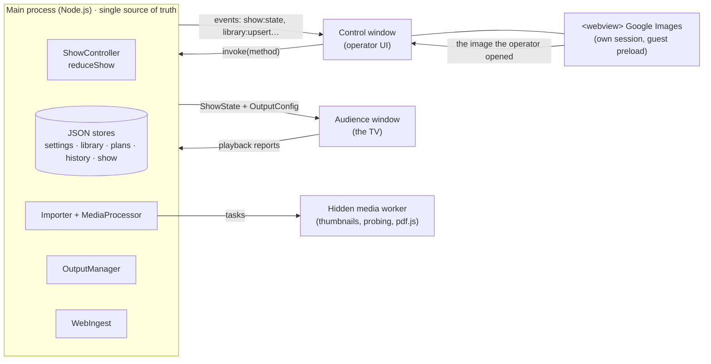

# How Cue is built

Cue is an Electron app: one Node.js **main process** that owns all state, and a few Chromium **renderers** that draw it. Everything is TypeScript; the UI is React. This document is a map for anyone changing the code.

## Source layout

| Path                     | What lives there                                                                   |
| ------------------------ | ---------------------------------------------------------------------------------- |
| `src/shared/`            | Types, IPC contract, defaults and pure logic shared by every process               |
| `src/shared/show/`       | The show reducer: Preview/Live, standby, paging, Back, overlays, video transport   |
| `src/main/`              | App startup, IPC handlers, menus, shortcuts, windows                               |
| `src/main/store/`        | Crash-safe JSON stores for settings, library, plans and history                    |
| `src/main/media/`        | Importing, processing (via the worker), web ingest                                 |
| `src/main/show/`         | `ShowController`: resolves what to show, persists it, handles video endings        |
| `src/main/output/`       | `OutputManager`: places the audience window on the right display                   |
| `src/main/plans/`        | `.cueplan` export and import (a zip of the plan and its media)                     |
| `src/main/scripture/`    | Bible lookups in the bundled translations                                          |
| `src/main/search/`       | Wikimedia Commons, Openverse and Pexels search                                     |
| `src/preload/`           | Sandboxed bridges for each kind of window, plus the Google guest page              |
| `src/renderer/stage/`    | The **Stage**: everything the audience sees, shared by the output and the monitors |
| `src/renderer/control/`  | The operator UI: layout, features, stores, UI primitives                           |
| `src/renderer/audience/` | The audience window: a stateless mirror of main's show state                       |
| `src/renderer/worker/`   | The hidden worker page: decoders and pdf.js                                        |
| `resources/bible/`       | The World English Bible and King James Version, gzipped JSON                       |
| `tests/unit/`            | Vitest unit tests                                                                  |
| `tests/e2e/`             | Playwright tests that drive the built app                                          |

## Processes and windows

- **Main process** (`src/main/index.ts`) creates the stores and services, wires their events to the windows, and answers the control window's calls. Nothing else holds state that matters: renderers can reload or crash and pick up where they were.
- **One Cue at a time.** A second launch (say, double-clicking a `.cueplan` file) hands its files to the running Cue, which confirms by writing a note to `launches/` in the data folder, and then quits. If nobody answers, because a Cue has just crashed and Windows still holds its lock, the launch keeps trying for up to 15 seconds and then starts normally. A Cue that is still running but has lost its window restarts itself when Cue is opened again (a second launch, or a click on the Dock icon on a Mac), so the launch doesn't vanish into it. If a running Cue never answers at all, the new launch says so instead of quitting silently.
- **Starting is never silent.** The control window is shown when its first frame is ready, or after four seconds regardless, so a slow or broken page can't leave Cue running with nothing on screen. If the page fails to load or its process keeps crashing, a dialog offers to try again, show the log or quit; an error during startup shows the reason and where the log is (`src/main/index.ts`, `src/main/windows/control.ts`).
- **Control window** loads `control.html`. Its preload exposes `window.cue` with `invoke(method, ...args)` and `on(event, listener)`. A zustand store (`lib/store.ts`) mirrors main's state from events; a second store (`lib/ui.ts`) holds UI-only state such as the current tab, dialogs and selection.
- **Audience window** loads `audience.html` and renders `<Stage role="output">` from the `ShowState` main sends it. It reports video and audio playback back to main, which re-broadcasts it so the Live monitor stays in sync.
- **Media worker** is a hidden window with Chromium's decoders and pdf.js. Main sends it tasks (image and video thumbnails, media probing, PDF pages) and enforces a timeout on each, so a bad file can never hang an import. If the worker crashes or a task times out, the worker is restarted; the other files it was working on are retried once, so one corrupt file doesn't fail its neighbours. On quit, the worker and the audience window are shut down for good: a late event can't open a window that would keep Cue running.
- **Google Images** runs in a `<webview>` inside the control window, in its own session (`persist:web`) with its own cookies. A guest preload (`src/preload/webview.ts`) watches for the image the operator opens and tells the control window about it.

### IPC

The contract is typed in `src/shared/ipc.ts`:

- `CueApi` maps each method (`show:dispatch`, `library:import`, `plans:export`…) to its arguments and result. Main registers handlers with `handle(method, fn)` (`src/main/handlers.ts`). Only the control window is a trusted caller; anything else is rejected.
- Failures come back as `{ ok: false, error }` values rather than rejected promises. The preload turns them back into thrown `Error`s, so the renderer can simply `await` and catch. Errors thrown as `UserError` (`src/main/errors.ts`: a site refusing a download, an unsupported file, a reference that isn't in the Bible) are expected and logged as warnings without stack traces; their message is written for the operator.
- `CueEvents` are broadcast from main to the control window: `show:state`, `library:upsert`, `plans:changed`, `settings:changed`, `displays:changed`, `updates:changed`, `toast`, `progress`, `ui:command` and `plans:open`.

## The show engine

`reduceShow(state, command, context)` in `src/shared/show/reducer.ts` is a pure function and holds all of Cue's live workflow rules. The controller supplies a `ShowContext` (how to resolve a target into a `Presentation`, the next plan entry, the settings), applies the result, persists it and acts on the returned effects.

- **Preview and Live.** `preview` stages something; `take` (Space) moves it to Live with a new instance id, which is what makes the output transition. `show` puts something on screen directly.
- **Standby.** When something from a plan goes live, the plan's cursor moves there and the following entry is staged in Preview. Spontaneous items don't move the cursor, so Preview returns to the plan afterwards.
- **Paging.** `next` and `prev` step through PDF and slide pages in place (no transition). At the last page they stop and report a boundary, or, with _Next continues into the next item_, take the standby. After a blackout or ambient, the first press only brings the content back.
- **Back.** Paged content is sticky: after slides → map → photo, Back still returns to the slides at the page you left; once the slides are back, Back offers the last spontaneous item.
- **Overlays.** Blackout and ambient sit above the content, so lifting them reveals exactly what was there. Ambient keeps its presentation while fading out.
- **Video.** Transport is declarative: Live carries `playing` and a `seek { time, nonce }`. Bumping the nonce asks the output to jump; the output reports its position back as `PlaybackStatus`.

`ShowController` (`src/main/show/controller.ts`) builds presentations from library items and plan entries, applies per-item options (fit, start and end times, loop, end action), keeps on-screen presentations up to date when their media changes (a PDF still rendering, a deck edited live), and writes the state to `show.json` with `cleanExit: false`. A clean quit sets it to `true`; if Cue starts and finds `false` with something on screen, it puts the audience screen back the way it was. It also notes the live video's position every few seconds, so a video picks up where it was when the audience window reloads or Cue restarts.

## The Stage

`src/renderer/stage/Stage.tsx` renders the audience picture, and the very same component draws the Preview and Live monitors in the control window, so what you see is what the room sees.

- **Layers:** content (with transitions) → credit → ambient → test pattern → blackout → display identification.
- **Transitions:** each presentation instance gets a slot. A new slot loads invisibly and is revealed only once its media is ready (a slide waits for its fonts and its background picture or video), then fades or dips in while the old one leaves, so there's never a flash of black or a half-loaded image. Cut, fade and dip are supported. Each PDF page is its own slot; slides that share a background share one, and only their words cross-fade (`SlideView`), so a looping background video plays on. A video cut away from stays mounted, unseen, until its sound has faded out, so a cut never clicks.
- **Pictures:** fit, fill and blur-fill (the image over a blurred, enlarged copy of itself), plus zoom and pan in normalized coordinates, so a zoom set in a small monitor matches the TV exactly.
- **Video and audio** play only on the output, through the chosen audio device (`setSinkId`) with short volume ramps. The monitors show the same frames but stay silent, following the output's playback reports.
- **Slides** are laid out on a fixed 1920 × 1080 canvas and scaled to fit, so a deck looks identical everywhere; text shrinks to fit its box automatically.
- **Ambient** is either a WebGL shader (slow, drifting light, driven by the wall clock so every view is in step) or a playlist of the church's own photos and videos with a gentle Ken Burns move, with an optional text, clock or countdown on top. Each playlist item fades in over the previous one once it has loaded.

## Scripture

References are parsed in `src/shared/scripture.ts`: all 66 books with their usual abbreviations ("jn", "1 cor", "Ps", "II Kings"), single verses, ranges, whole chapters, ranges across chapters ("Rom 8:38–9:2") and one-chapter books ("Jude 3"). `Bible` (`src/main/scripture/bible.ts`) loads a translation from `resources/bible/<id>.json.gz` on first use (`{ id, name, abbr, books: [{ id, name, chapters: string[][] }] }`) and answers `scripture:passage`. In the renderer, `lib/scripture.ts` turns a passage into scripture slides: verse numbers appear as superscripts when there's more than one verse, and `splitPassage` spreads a long passage over the fewest slides that hold it, evenly. One slide is shown directly; several become a deck that stays out of the library unless it's saved. `scripts/build-bible.mjs` (`npm run bible`) downloads and converts the texts. Only public-domain translations are bundled.

## Media

1. **Import** (`src/main/media/importer.ts`): files are identified by content (magic bytes, not only the extension), deduplicated by a fingerprint hash, and copied into `Media/<id>/`, using a copy-on-write clone where the file system supports it.
2. **Processing** (`processor.ts` + the worker): images get a thumbnail and their size; animated GIF/PNG/WebP are detected; videos are probed for size and duration; audio-only files become audio items; PDFs are rendered page by page to WebP at the chosen quality. Pages appear as they're rendered, so a long PDF is usable right away, and processing resumes after a restart.
3. **Serving:** renderers read media through the `cue-media://` scheme (`src/main/protocol.ts`), with HTTP range support so videos can seek. The app's own pages load from `cue-app://`, which gives them a proper origin without touching the network.

Web images picked but never saved are kept for 30 days unless a plan or the history still uses them.

### Images from the web

`WebIngest` (`src/main/media/webIngest.ts`) brings in the image the operator opened, in this order:

1. Download the original URL through the browser pane's own session, with the source page as referrer, so sites with hotlink protection still hand it over.
2. If the site refuses, copy the image out of the page itself, since the embedded browser is already displaying it. Electron addresses a `<webview>` by a point in the host window, so the page reports where the image is at that moment; the copied bitmap must match the image's natural size, so an overlay or a thumbnail is never shown by mistake. The operator's clipboard is restored afterwards.
3. Otherwise use Google's thumbnail, with a toast saying the copy is low resolution.

The guest preload doesn't depend on Google's markup, which changes often. It looks for the most prominent image on screen and follows Google's swap from its own thumbnail to the original.

## Storage

All data lives in the user data folder (see the README). Each store is a `JsonStore` (`src/main/store/jsonStore.ts`): debounced, atomic writes (temporary file, then rename), with the previous version kept as `.bak` and used automatically if the main file is ever unreadable. The corrupt file is set aside, never deleted.

| File            | Contents                                                     |
| --------------- | ------------------------------------------------------------ |
| `settings.json` | Settings, merged over defaults so new options appear safely  |
| `library.json`  | Media items and collections                                  |
| `plans.json`    | Service plans                                                |
| `history.json`  | What was shown, for "Shown today"                            |
| `show.json`     | The live state and the clean-exit flag, for crash recovery   |
| `Media/`        | One folder per item: the file, its thumbnail, rendered pages |
| `logs/cue.log`  | Rotating log                                                 |

## Displays

`OutputManager` (`src/main/output/output.ts`) decides where the audience window goes. In **Auto** it uses the external display (remembering which one by its identity, so it returns when reconnected) and never covers the operator's own screen; with one display it waits and says so. **Fullscreen**, **Window** and **Off** override that. It reacts to displays being plugged in or removed, keeps the computer from sleeping while something is on screen, and can show each display's number for identification.

The fullscreen window must cover its display exactly, no more: anything extra lands on the screen next to it, usually the operator's, as a strip that stays on top of everything. On Windows that happened: a frameless window still has an invisible sizing border, and one that can't be resized is never allowed to be smaller than its size plus that border, so the picture was 14 px wider and 7 px taller than the screen. The fullscreen window is therefore created without that border (`thickFrame: false`). As a second line of defence, `OutputManager.settle` compares the window with its display after placing it, in the display's own pixels (`screen.dipToScreenRect`, so screens with different scaling are covered too), corrects it if it's off, and checks again shortly after; each placement and correction is logged. A window that is already on the right display is never placed again (only checked), so moving the control window or a display change doesn't blink the room's screen. The fullscreen window can't take keyboard focus on Windows and macOS: every key belongs to the control window.

## Updates

`Updates` (`src/main/updates.ts`) owns an `UpdateState` that the control window mirrors (`updates:state`, `updates:check`, `updates:install`, and the `updates:changed` event). It looks for a new version 15 seconds after startup and every six hours, while **Settings → Library → Keep Cue up to date** is on. It doesn't run in development or under test (unless a test supplies its own feed, below), and it never restarts Cue by itself. A check that fails is a warning in the log: no dialog, no toast.

- **An installed Cue on Windows** uses electron-updater (bundled into `out/main` like everything else). It reads `latest.yml` from the newest GitHub release, downloads the installer in the background and checks it against the SHA-512 in that file; the builds aren't signed, so there is no publisher signature to compare, and no check is switched off. The update installs silently when Cue is closed. **Update ready → Restart now** in the top bar installs it at once; if something is on the audience screen, it asks a second time first.
- **Everywhere else** (macOS, Linux, an unpackaged Cue) the app can't replace itself, which would need a signed build. Cue asks the GitHub API for the latest release, compares its tag with its own version (`src/shared/updates.ts`) and shows **Update available**; **Get it** opens the release page in the browser. Only Cue's own release pages are opened, whatever the answer says.
- **For tests**, `CUE_UPDATE_FEED` replaces the releases with a server on the same computer. Only `http://127.0.0.1:<port>` or `http://localhost:<port>` is accepted; anything else is ignored with a warning. On an installed Windows Cue it is a folder holding `latest.yml` and the installer; elsewhere Cue reads `<feed>/latest.json` (`tag_name`, `html_url`). With a feed, the first check comes one second after the window opens.

## Security

- Every window uses context isolation and a sandboxed preload; nothing in a renderer can reach Node.js.
- Each page has a strict Content-Security-Policy (`electron.vite.config.ts`). Only the control page may load `https:` images (search thumbnails); the audience page shows local media only.
- Cue's windows only load the bundled pages; navigation and new windows are refused. External links open in the system browser.
- The `<webview>` is configured by main, not by the page: its preload, partition and web preferences are fixed in `will-attach-webview`, and it can't open windows.
- Permissions are allowlisted per session: Cue's windows may enumerate audio outputs, choose a speaker and go fullscreen; the browser pane may only go fullscreen and write to the clipboard.
- IPC handlers only answer the control window.
- Installing and updating never ask anyone to lower their guard: the one-line installers verify a SHA-256 before running anything, the updater verifies a SHA-512, and neither touches SmartScreen, Defender or Gatekeeper settings.

## Look and motion

The control window is a quiet, rounded desk in the church's own colours. The rules that keep it that way live in `src/renderer/styles/tokens.css`:

- **Colour.** Black into dark walnut for surfaces, warm beige for text. Sage green (`--accent-*`) is for anything you can act on and for what is selected. Gold (`--gold-*`) means standing by: staged in Preview, next in the plan. Red (`--live-*`) means on the screen right now, and nothing else is red.
- **Shape.** Everything is rounded, on one scale (`--r-4` to `--r-18`, plus `--r-pill` for lamps and chips), and nested corners get smaller as they go in. The three main panels and the bottom bar float on the black with a small gap (`--gap`) between them; the gap is also the resize handle.
- **Material.** Things that float over the desk (menus, popovers, tooltips, toasts, the command palette) are slightly see-through with the desk blurred behind them (`--glass`, `--glass-blur`). Panels are flat with a hairline of beige light.
- **Type.** The system's own face on a Mac (San Francisco) and Inter, its closest relative, everywhere else. Sentence case throughout; only the PREVIEW and LIVE lamps are capitals. Numbers that change use tabular figures. Slides keep their own typefaces (`stage/fonts.ts`).
- **Pointer.** Anything clickable shows the pointer cursor (one rule in `base.css`).

Motion is soft and springy, never slow: `--ease-spring` has a small overshoot and is used for things that arrive or settle (dialogs and menus grow from just behind the glass, chips and lamps pop, buttons give under the pointer and spring back). A global rule in `base.css` turns animation off for people who ask for reduced motion. Tabs and segmented controls share one raised highlight that slides between options (`ui/useSlidingThumb.ts` measures the selected option and the `.thumbHost` class draws it). When something goes on the screen a red ring leaves the Live monitor and its lamp pops; staging does the same in gold. Both are keyed on the presentation, so they play once per change. Entrance animations change opacity or transform only, never layout, so drag-and-drop geometry and E2E clicks aren't affected.

What the audience sees follows the same palette by default: new slides get a gold accent, and the ambient backgrounds start with Sage and Walnut (`AMBIENT_THEMES` in `stage/GenerativeBackground.tsx`).

## Tests

- **Unit** (`npm test`): the show reducer's workflow rules, scripture references and lookups, file-format detection, the justified image grid and utilities.
- **End to end** (`npm run test:e2e`): Playwright launches the built app per spec file, with `CUE_E2E=1`, a throwaway `CUE_USER_DATA` folder and `CUE_OUTPUT_MODE=window`, and drives it like an operator: keyboard, clicks, drag and drop. It checks results both in main's state (exposed as `globalThis.__cue` only in E2E mode) and in the pixels of the audience window. `CUE_GOOGLE_BASE` points the Google pane at a local stand-in (`tests/e2e/support/mock-google.ts`) that reproduces the thumbnail-then-original behaviour and hotlink protection, and `CUE_UPDATE_FEED` points the update check at a local stand-in for the releases (`tests/e2e/updates.spec.ts`). Fixtures (PNG, PDF, WAV) are generated by the tests; a small WebM clip is checked in.
- **The installers** (`tests/unit/install.test.ts`): `install.sh` runs with stand-ins for the macOS tools, to check that a download which doesn't match its checksum is never opened.

## Build

`electron.vite.config.ts` builds three targets: the main process (ESM), the preloads (each a single, self-contained CommonJS file, since sandboxed preloads can't load chunks), and the renderer pages. It also copies pdf.js's character maps, fonts and wasm decoders next to the renderer, so PDFs render offline, and injects each page's CSP. `electron-builder.config.mjs` packages `out/` into installers.

There is one download per platform, so nobody can pick the wrong one: a universal Mac disk image (Apple silicon and Intel) and a one-click Windows installer for x64, which also runs on ARM PCs. Their names carry no version (`Cue-mac.dmg`, `Cue-windows-setup.exe`), so `releases/latest/download/<name>` is a permanent link to the newest one. The disk image's window is drawn by `scripts/make-installer-art.mjs` (`npm run art`) from `build/installer/dmg-background.html`.

`publish` in the builder config names the GitHub repository. Nothing is uploaded by electron-builder (`--publish never`); the setting makes it write `app-update.yml` into the app, which tells an installed Cue where its releases are, and `latest.yml` next to the Windows installer, with the version and the installer's SHA-512.

`install.ps1` and `install.sh` in the repository root are the one-line installers from the README. Each downloads the installer and `SHA256SUMS.txt` from the latest release, refuses to go on unless the SHA-256 matches, installs (the Windows installer silently; the Mac app copied out of its disk image into Applications) and opens Cue. `CUE_INSTALL_FROM=<folder>` makes them use local files instead of downloading, `CUE_INSTALL_NO_LAUNCH=1` skips opening Cue, and `CUE_INSTALL_DIR` sets the Mac destination; the checksum can't be skipped.

The Release workflow (`.github/workflows/release.yml`) builds both platforms and then, on a clean machine:

1. **Windows only: proves the update.** The same code is packaged again as version 0.0.1 into `release-old/` and installed. `scripts/smoke-update.mjs` serves the real build's folder on localhost, starts the old Cue with `CUE_UPDATE_FEED`, waits for "Update … is ready" in its log, closes it normally, and then requires the installed Cue to report the new version.
2. **Installs with the one-line installers**, given the freshly built files (Windows PowerShell 5.1 and macOS's bash 3.2, fed the script as text the way `irm | iex` and `curl | bash` do).
3. **Runs `scripts/smoke-installed.mjs`** against the installed app: it has to show its window, draw the interface, read a verse from the bundled Bible, quit, and do it all a second time. The only setting it changes is switching the update check off, so the result doesn't depend on the network.

Nothing is published unless all of that passes. Run the workflow with a `version` (say `v1.0.0`) to tag and publish a release; without one it only builds and tests. The version must be the one in `package.json`, because Cue compares the two to decide whether it is out of date. A release carries five files: the two installers, `SHA256SUMS.txt` (written in the publish job), and `latest.yml` with the installer's `.blockmap` for the updater; the publish job checks that `latest.yml` describes the installer it is about to publish.
